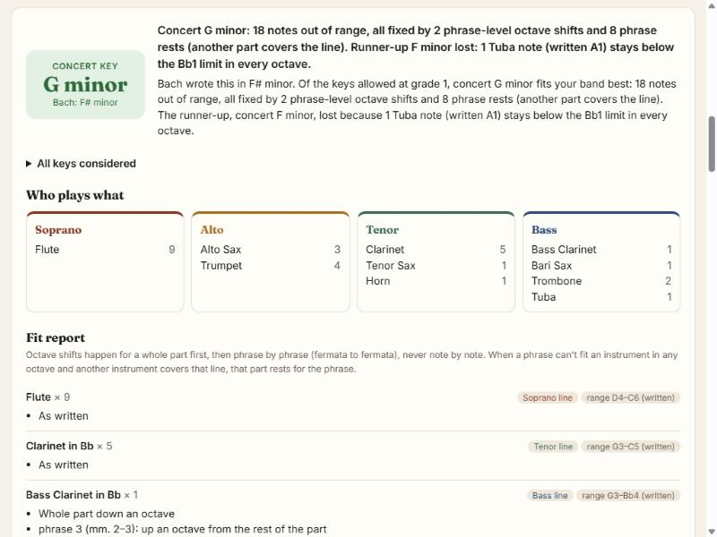

# Roster Chorale

Turn any Bach chorale into printable band parts scored for the band you actually have, at the grade you pick, in the concert key that keeps everyone in range.

**Live:** https://roster-chorale.vercel.app

1. Upload your roster (`.xlsx` / `.csv`) or paste rows from Excel or Google Sheets. Messy names like “Bb Clar”, “Alto Sax 1”, “Bari” and “Tbn” are cleaned up. Anything unrecognised is listed with a dropdown so you can classify it.
2. Pick a chorale (search by BWV number or title, or **Surprise me**) and a target grade (½, 1, 2 or 3).
3. **Arrange** → the chosen concert key and why the runner-up lost, who plays which voice, a fit report, and every part engraved in the browser, transposed for its instrument.
4. **Print all parts** (one part per page; choose “Save as PDF” in the print dialog) or **Download MusicXML (.zip)** to open in MuseScore.




## How it decides

For every concert key the grade allows, it tries every instrument on every voice (soprano, alto, tenor, bass):

1. **Whole-part octave shift.** Move the instrument's whole line up or down by octaves to fit its range at that grade. Ranges are checked in *written* pitch, after transposing for Bb, Eb and F instruments.
2. **Phrase-level octave shift.** If notes are still out of range, move whole phrases (fermata to fermata) by an octave. Never single notes.
3. **Phrase rests.** If a phrase can't fit an instrument in *any* octave and another instrument on the same voice plays it cleanly, that part rests for the phrase. No part rests for more than half its phrases.

Voices are then assigned so that every voice is covered, the bass line goes to low instruments, no upper voice is pushed below the bass (which would invert the chords), each instrument plays a voice it suits, and no voice is left thin. The key with the fewest notes still out of range wins. Ties go to fewer octave fixes, more natural voicing, and then the smallest move from Bach's key.

If no allowed key fits everyone, the page says so in red, picks the least-bad key, and lists every problem note by measure.

### Grades (`data/grades.json`)

The grade table is plain JSON you can edit. **These are starting values: conservative and approximate. Check them against your state's grading guide.** Each grade sets:

| | Ranges | Concert keys | Rhythm |
|---|---|---|---|
| ½ and 1 | narrow (e.g. trumpet Bb3–C5, tuba Bb1–C3, written) | Bb, Eb, F, Ab major; G, C, F minor | eighth-note pairs merged into a quarter that keeps the on-beat pitch; ties across barlines removed; fermatas kept |
| 2 | wider | adds C, Db major and Bb minor | sixteenths simplified to eighths |
| 3 | wider still | up to 4 flats or 2 sharps | as written |

Ranges are written pitch, inclusive, in music21 spelling (`B-4` = B♭4). The spec started grade-1 tuba at Bb1–Bb2; it is now Bb1–C3. Tuba and bass clarinet are still the most common reason a grade-1 arrangement ends up “least-bad” (usually one or two notes), so widen those ranges if your players can manage it.

## Run it locally

Needs [uv](https://docs.astral.sh/uv/).

```powershell
uv sync
uv run uvicorn app:app --port 8321
```

Then open http://localhost:8321. There is also a CLI:

```powershell
uv run python -m roster_chorale samples/lopsided-band.xlsx --chorale bwv66.6 --grade 1 --out out/
```

It writes one MusicXML file per instrument plus `fit-report.txt`.

Tests (alias mapping, roster parsing, written-pitch ranges, key search, voice coverage, rhythm simplification, phrase-only octave shifts, and a check that every written part transposes back to the right concert pitches):

```powershell
uv run pytest
```

## Deploy (Vercel)

```powershell
vercel login
vercel deploy --prod
```

Vercel detects FastAPI from `app.py`. `public/` (the page and the sample roster) is served by the CDN. The Python function bundles music21 and its Bach corpus, and the first request after a cold start takes a few seconds while music21 loads (the page shows “Warming up…”). Nothing is stored on the server: rosters are processed in memory per request. The browser keeps your last roster in localStorage.

## Project layout

```
app.py                     FastAPI: /api/roster, /api/chorales, /api/arrange, /api/zip
public/index.html          the whole front end (vanilla JS + Verovio 6.4.1 for engraving)
roster_chorale/
  instruments.py           standard instruments, transpositions, voice preferences, name aliases
  roster.py                .xlsx / .csv / pasted-text roster parsing and counting
  chorale.py               corpus loading, phrases (fermatas), rhythm simplification
  arrange.py               key search, voice assignment, octave fitting, MusicXML parts, fit report
data/grades.json           ranges, keys and rhythm rules per grade (edit me)
data/chorales.json         the 355 clean four-part chorales (rebuild: scripts/build_catalog.py)
samples/lopsided-band.xlsx a realistic messy roster (invented first names)
```

## Notes and limits

- Chorales come from the [music21](https://www.music21.org/) corpus: the 371 Riemenschneider chorales plus other plain chorale files (such as BWV 66.6), keeping only the 355 with exactly four parts named Soprano/Alto/Tenor/Bass. Where music21 has no title for a chorale, it is listed as “Chorale from BWV …”.
- Repeat signs in the source are not reproduced: repeated sections print once.
- One part per instrument (no Clarinet 1/2). Euphonium is bass clef. Mallets and percussion are not included.
