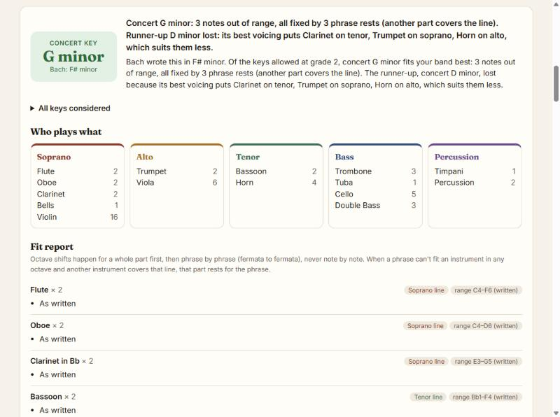
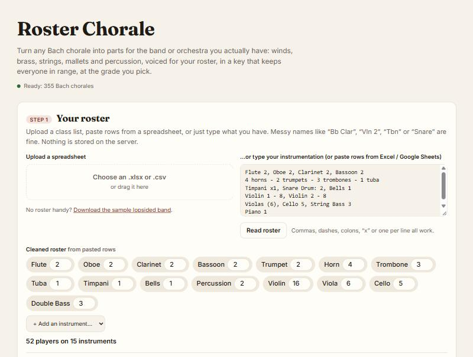
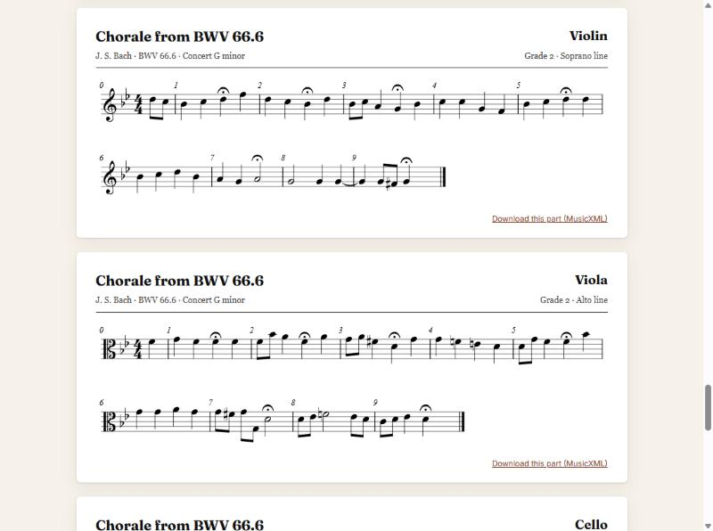
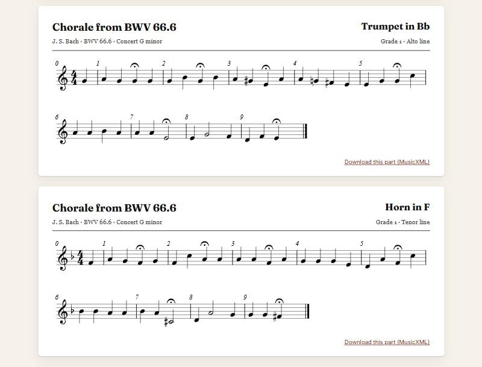
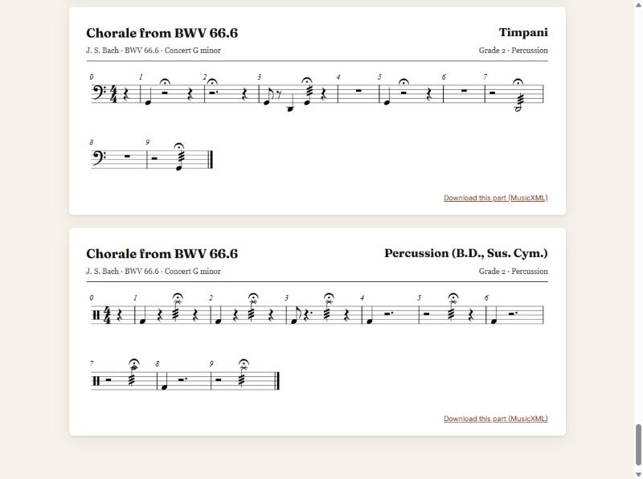
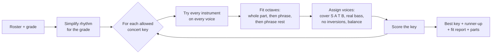

<div align="center">

# 🎼 Roster Chorale

**Turn any Bach chorale into printable parts for the band or orchestra you *actually* have.**

Winds, brass, strings, mallets and percussion — voiced for your roster, in a concert key that keeps everyone in range, at the grade you pick.

[](https://roster-chorale.vercel.app)

[](https://github.com/tpcameron-cc/roster-chorale/actions/workflows/tests.yml)


[](LICENSE)



</div>

---

## Why

It's Sunday night. Monday's warm-up needs a chorale. Your band has nine flutes, one tuba, no oboes and a percussion section that wants something to do. The printed chorale books are in fixed keys with fixed parts, and half your kids can't reach the notes.

Roster Chorale starts from **the players you have** and **the grade you're aiming for**, then picks the key, the voicing and the octaves so that everyone can play — and tells you exactly what it changed and why.

## ✨ What it does

| | |
|---|---|
| 📋 **Reads any roster** | Upload `.xlsx`/`.csv`, paste rows from Excel or Google Sheets, or just type `Flute 9, Clarinet 5, Tuba 1`. Messy names like “Bb Clar”, “Vln 2”, “Bari” or “Snare” are cleaned up; anything unknown is listed for you to classify. |
| 🎚️ **Targets a grade** | Grade ½, 1, 2 or 3 sets each instrument's range, the allowed concert keys, and how much the rhythm is simplified. |
| 🔑 **Chooses the key** | Tries every allowed key, counts how many notes fall out of range for *your* roster, and explains the winner and why the runner-up lost. |
| 🎻 **Voices the chorale** | Puts every instrument on soprano, alto, tenor or bass so every line is covered, the bass goes to low instruments, and no chord is turned upside down. |
| ✂️ **One part or split sections — your call** | *One per instrument* gives every flute the same part. *Split sections* divides each section across the lines it suits — Flute 1/2, Clarinet 1/2/3, Trumpet 1/2, Violin 1/2. Either way, small groups split when needed so all four lines are heard (a clarinet quartet, a flute choir, two trumpets and a horn). |
| 🔁 **Fits octaves by phrase** | Moves whole parts, then whole phrases (fermata to fermata) — never single notes — and rests a part for a phrase only when someone else covers it. |
| 🥁 **Writes percussion too** | Timpani on tonic and dominant at the cadences; bass drum and suspended cymbal framing every phrase. |
| 🖨️ **Prints real parts** | Every part is transposed (Bb, Eb, F, octave instruments, alto clef…) and engraved in your browser. Print all parts as PDF, one per page, or download MusicXML for MuseScore. |
| 🔒 **Stores nothing** | No accounts, no database. Rosters are processed in memory per request. |

## 🚀 Try it in 60 seconds

Open **[roster-chorale.vercel.app](https://roster-chorale.vercel.app)**, then:

1. **Add your roster.** Upload a spreadsheet, paste rows, or type it. No roster handy? Use the sample [`lopsided-band.xlsx`](samples/lopsided-band.xlsx).
2. **Pick a chorale** by BWV number or title — or hit **🎲 Surprise me** — choose a **target grade**, and choose **one part per instrument** or **split sections**.
3. **Arrange.** Read the key decision, see who plays what, and check the fit report.
4. **Print all parts** (choose *Save as PDF* in the print dialog) or **Download MusicXML (.zip)**.
5. Switch the grade from **1** to **3** and arrange again: the eighth-note passing tones come back and the octave fixes disappear.

<table>
<tr>
<td width="50%"><br><sub><b>Type it however you like.</b> “Violin 1 - 8, Violin 2 - 8” becomes 16 violins; Piano is flagged for you to classify.</sub></td>
<td width="50%"><br><sub><b>Real, transposed parts.</b> Viola in alto clef, fermatas on every part, measure numbers on every bar.</sub></td>
</tr>
<tr>
<td width="50%"><br><sub><b>Transposing instruments handled.</b> Concert G minor → Trumpet in Bb reads A minor, Horn in F reads D minor.</sub></td>
<td width="50%"><br><sub><b>Percussion that frames the phrases.</b> Timpani cadences and rolls; bass drum and suspended cymbal.</sub></td>
</tr>
</table>

## ⌨️ Typing your roster

Any of these work in the roster box — commas, dashes, colons, `x`, `=`, parentheses, bullets, or one per line:

```text
Flute 9, Clarinet 5, Trumpet 4, Tuba 1
9 flutes - 4 trumpets - 2 snare drums
Violin: 12
Viola x4
Violins (12), violas (4) and cellos (5)
Violin 1 - 8, Violin 2 - 8
- Cello 5
- String Bass 2
```

Spreadsheet paste still works too: one row per student (the instrument column can be anywhere; a header like *Instrument*, *Inst* or *Section* helps) or instrument-and-count pairs. Nothing is stored on the server; the browser just remembers your last roster in `localStorage`.

## 🎺 Instruments

| Family | Instruments | What they play |
|---|---|---|
| **Woodwinds & brass** | flute, oboe, Bb clarinet, bass clarinet, bassoon, alto/tenor/bari sax, Bb trumpet, F horn, trombone, euphonium, tuba | a chorale line, transposed |
| **Strings** | violin, viola *(alto clef)*, cello, double bass *(reads an octave up)* | a chorale line |
| **Mallets** | bells *(read two octaves down)*, xylophone *(one octave down)*, marimba, vibraphone | doubles a line someone else covers — usually the melody |
| **Timpani** | two drums tuned to the tonic and dominant | the opening note and each phrase's cadence; from grade 2 also tonic/dominant downbeats and rolls on fermatas |
| **Percussion** | snare, bass drum, cymbals, triangle, drum set… *(one shared part)* | bass drum on each phrase's first downbeat, suspended cymbal on every fermata *(rolled from grade 2)* |

Bach wrote no percussion, so those parts frame the phrases rather than adding rhythm. Piano, harp and guitar aren't parts yet — classify them as the nearest instrument (marimba works nicely for piano).

## 🧠 How it decides



1. **Rhythm by grade.** Grade ½–1 merges eighth-note pairs into a quarter that keeps the on-beat pitch and removes ties across barlines; grade 2 turns sixteenths into eighths; grade 3 plays as written. Fermatas always stay.
2. **Whole-part octave.** Each instrument's line moves up or down by octaves to sit in its range — checked in **written** pitch, after transposing.
3. **Phrase-level octave.** If notes still fall outside, whole phrases (fermata to fermata) move by an octave. Never single notes.
4. **Phrase rests.** If a phrase can't fit an instrument in any octave *and* another instrument on that line plays it cleanly, that part rests for the phrase (never more than half its phrases).
5. **Parts per instrument.**
   - *One per instrument* (default): one part per instrument. Only if there are fewer instrument types than lines do sections with players to spare split (Flute 1, Flute 2…) until every line is covered — as many lines as there are players, up to four.
   - *Split sections*: every section with two or more players divides across the lines it suits, up to three parts and never more parts than players — Flute 1/2 on soprano/alto, Clarinet 1/2/3 on soprano/alto/tenor, Trombone 1/2 on tenor/bass, Violin 1/2, Viola 1/2, Cello 1/2. Mallets, timpani and percussion stay as one part.
   - Part 1 always takes the highest line and the larger group of players.
6. **Voicing.** Every voice is covered; the bass goes to low instruments and someone plays it at pitch or lower; no upper voice is pushed below the bass (that would invert the chords); instruments get lines that suit them; no voice is left thin; mallets only double.
7. **Lines in order.** Nothing sounds above the melody or below the bass: if a part has to move up an octave (say, a clarinet playing the bass line), the parts above it follow when their range allows. If it can't be avoided, the page says so.
8. **Key score.** Fewest notes still out of range wins, then fewer octave fixes, more natural voicing, keys familiar to each section, and finally the smallest move from Bach's key. If nothing fits, you get the **least-bad** key in red, with every problem note listed by measure.

**Mixed groups.** Winds use the band key list for the grade (flat keys); strings use the string list (sharp keys). A full orchestra tries both, costs each player a little when a key is off their section's list, and tells you when one section is reading an unfamiliar key.

## 🎚️ Grades

Everything lives in [`data/grades.json`](data/grades.json) — plain JSON you can edit.

| Grade | Ranges (written) | Concert keys | Rhythm |
|---|---|---|---|
| **½ and 1** | narrow — e.g. trumpet B♭3–C5, tuba B♭1–C3, violin G3–B5 | **band:** B♭, E♭, F, A♭ major; G, C, F minor<br>**strings:** D, G, C, A major; E, A, D minor *(grade ½: D, G; E, A)* | eighths → quarters, no ties across barlines |
| **2** | wider | band adds C, D♭ major, B♭ minor · strings add F, B♭ major, B, G minor | sixteenths → eighths |
| **3** | wider still | band: up to 4♭ or 2♯ · strings: up to 2♭ or 4♯ | as written |

> [!NOTE]
> These are **starting values — conservative and approximate.** Check them against your state's grading guide. Ranges are written pitch, inclusive, in music21 spelling (`B-4` = B♭4). The grade-1 tuba and bass clarinet ranges are the most common reason a grade-1 arrangement ends up “least-bad”; widen them if your players can manage.

```json
"Tuba": ["B-1", "C3"],
"Violin": ["G3", "B5"],
```

## 💻 Run it locally

You need **[uv](https://docs.astral.sh/uv/)** (it installs Python 3.12 for you).

```bash
git clone https://github.com/tpcameron-cc/roster-chorale.git
cd roster-chorale
uv sync
uv run uvicorn app:app --port 8321
```

Open <http://localhost:8321>. The first request takes a couple of seconds while music21 loads the Bach corpus.

### Command line

```bash
uv run python -m roster_chorale samples/lopsided-band.xlsx --chorale bwv66.6 --grade 1 --out out/
uv run python -m roster_chorale samples/lopsided-band.xlsx --chorale bwv66.6 --grade 2 --parts multiple --out out/
```

Writes one MusicXML file per instrument plus `fit-report.txt`, and prints the report.

### Tests

```bash
uv run pytest
```

About 400 tests cover alias mapping, roster parsing (xlsx, csv, pasted and typed), written-pitch ranges for every transposing instrument, key search, voice coverage, rhythm simplification, phrase-only octave shifts, timpani tuning, and a **musical-correctness check**: every written part is transposed back to concert pitch and compared note for note with the voice it was assigned.

## 🔌 API

Interactive docs at [`/api/docs`](https://roster-chorale.vercel.app/api/docs).

| Method | Path | Body | Returns |
|---|---|---|---|
| `GET` | `/api/chorales` | — | the 355 clean four-part chorales, instruments and grades |
| `POST` | `/api/roster` | multipart `file` (.xlsx/.csv) **or** form field `text` | cleaned counts + unrecognised names |
| `POST` | `/api/arrange` | `{"roster": {...}, "chorale": "bwv66.6", "grade": "1", "parts": "single"}` — `parts` is `"single"` (default) or `"multiple"` | key decision, voicing, fit report, MusicXML per part |
| `POST` | `/api/zip` | same as `/api/arrange` | `application/zip` of all parts + `fit-report.txt` |

```bash
curl -s -X POST https://roster-chorale.vercel.app/api/roster -F "text=Flute 9, Clarinet 5, Tuba 1"

curl -s https://roster-chorale.vercel.app/api/arrange \
  -H "content-type: application/json" \
  -d '{"roster":{"Flute":9,"Clarinet":5,"Tuba":1},"chorale":"bwv66.6","grade":"1"}'
```

## ▲ Deploy your own

The app is one static page plus one Python function, built for [Vercel](https://vercel.com)'s free tier.

```bash
npm i -g vercel
vercel login
vercel deploy --prod
```

Vercel detects FastAPI from `app.py` and serves `public/` from its CDN. The function bundles music21 and its Bach corpus (well under the 500 MB limit); a cold start takes a few seconds, and the page shows *Warming up…* meanwhile.

## 🗂️ Project layout

```
app.py                      FastAPI: /api/roster, /api/chorales, /api/arrange, /api/zip
public/index.html           the whole front end (vanilla JS + Verovio 6.4.1)
roster_chorale/
  instruments.py            instruments, transpositions, voice preferences, name aliases
  roster.py                 .xlsx / .csv / pasted rows / typed-list parsing
  chorale.py                corpus loading, phrases (fermatas), rhythm simplification
  arrange.py                key search, voicing, octave fitting, MusicXML parts, fit report
  percussion.py             timpani and percussion parts
data/grades.json            ranges, keys and rhythm rules per grade  <- edit me
data/chorales.json          catalog of 355 chorales (rebuild: scripts/build_catalog.py)
samples/lopsided-band.xlsx  a realistic messy roster (invented first names)
tests/                      pytest suite
docs/                       screenshots and the original build spec
```

## ⚠️ Limits

- Chorales come from the [music21](https://www.music21.org/) corpus: the 371 Riemenschneider chorales plus other plain chorale files (such as BWV 66.6), keeping the **355** with exactly four parts named Soprano/Alto/Tenor/Bass. Chorales without a title in music21 appear as “Chorale from BWV …”.
- Repeat signs in the source aren't reproduced; repeated sections print once.
- Split sections go up to three parts per instrument (no Horn 4 or Trumpet 4). Euphonium is bass clef.
- No dynamics, articulations or audio playback.

## 🙏 Credits

- **J. S. Bach** — the chorales (public domain).
- **[music21](https://www.music21.org/)** (BSD) — corpus, parsing, transposition and MusicXML export.
- **[Verovio](https://www.verovio.org/)** (LGPL) — in-browser engraving, loaded from jsDelivr.
- **[FastAPI](https://fastapi.tiangolo.com/)**, **[openpyxl](https://openpyxl.readthedocs.io/)**, **[uv](https://docs.astral.sh/uv/)**.

## 📄 License

[MIT](LICENSE). The grade table is a starting point, not an official standard — please adapt it for your program.
